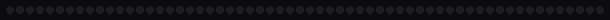
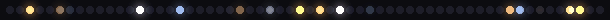
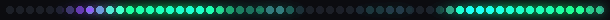
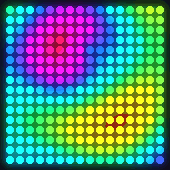
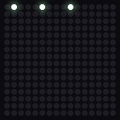
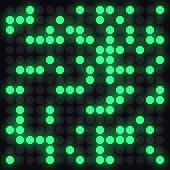
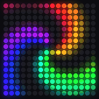
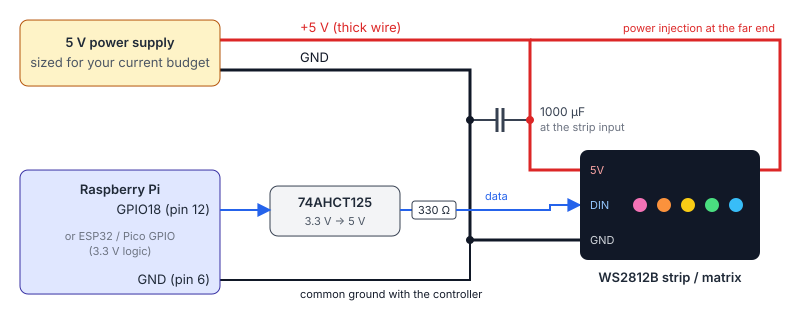

# led-lights

Animations for WS2812 / NeoPixel LED strips and 16×16 matrices that run on real hardware (Raspberry Pi, ESP32, Pico) **and** in a simulator, so you can see them without any LEDs.

**[Try it in the browser](https://pscactux.github.io/led-lights/)**: the web simulator runs a JavaScript port of every effect.

| Strip effects (60 LEDs) | |
|---|---|
| `rainbow` |  |
| `comet` |  |
| `fire` |  |
| `twinkle` |  |
| `breathing` |  |
| `color_wipe` |  |
| `theater_chase` |  |
| `plasma` |  |
| `aurora` |  |
| `meteor_rain` |  |
| `bouncing_balls` |  |
| `heartbeat` |  |

| `plasma2d` | `matrix_rain` | `life` | `spiral` |
|---|---|---|---|
|  |  |  |  |

All GIFs are produced by `led-lights gallery` from the same code that drives the hardware.

## Effects

| Name | Kind | What it does |
|---|---|---|
| `rainbow` | strip | Scrolling HSV rainbow |
| `comet` | strip | Bright head bouncing back and forth with a fading tail |
| `fire` | strip | Heat-diffusion fire (the classic Fire2012): sparks at the base rise, diffuse and cool |
| `twinkle` | strip | Stars fading in and out over a night-blue sky |
| `breathing` | strip | The `exp(sin(t))` "sleep LED" curve, with a drifting hue |
| `color_wipe` | strip | Fill one LED at a time, then wipe with the next color |
| `theater_chase` | strip | Marquee: every third LED on, marching along |
| `plasma` | strip | Sum of sine waves through a palette |
| `aurora` | strip | Fractal value noise curtains in green and violet |
| `meteor_rain` | strip | Meteors with trails that decay at random |
| `bouncing_balls` | strip | Gravity and restitution, pixel 0 is the floor |
| `heartbeat` | strip | Lub-dub at 72 bpm spreading from the middle |
| `plasma2d` | matrix | Demoscene plasma |
| `matrix_rain` | matrix | Falling green code rain |
| `life` | matrix | Conway's Game of Life on a torus, colored by age, reseeds when stale |
| `spiral` | matrix | Rotating three-armed rainbow spiral |

## Run it

Needs Python 3.12 and [uv](https://docs.astral.sh/uv/).

### Without hardware

```bash
uv sync
uv run led-lights list                       # all effects
uv run led-lights run fire                   # live preview in the terminal (24-bit color)
uv run led-lights run spiral                 # matrix effects default to 16x16
uv run led-lights gif aurora -o out/a.gif    # render a GIF
uv run led-lights gif fire -o out/fire.png   # .png = space-time strip (one row per frame)
uv run led-lights gallery                    # re-render docs/gifs/
uv run pytest                                # tests
```

Or open `web/index.html` in a browser (no build step).

Useful flags for `run`: `--leds 144`, `--fps 60`, `--brightness 0.6`, `--max-ma 2000`, `--gamma 2.6`, `--duration 10`.

### Raspberry Pi (rpi_ws281x)

```bash
uv sync --extra rpi
sudo .venv/bin/led-lights run fire --backend rpi --leds 60 --max-ma 2000
sudo .venv/bin/led-lights run life --backend rpi --zigzag   # serpentine 16x16 panel
```

Root is needed for DMA. On GPIO18 (PWM) turn off onboard audio (`dtparam=audio=off`). `rpi_ws281x` supports the Pi 1 to 4 and Zero; it does not support the Pi 5. The library is imported lazily, so the package still installs on a Mac or PC.

### ESP32 / Raspberry Pi Pico (MicroPython)

[`micropython/main.py`](micropython/main.py) is a self-contained port of six effects (rainbow, comet, fire, twinkle, breathing, theater chase) using the built-in `neopixel` module. Edit `PIN`, `NUM_LEDS`, `BRIGHTNESS` and `MAX_MA` at the top, then:

```bash
mpremote cp micropython/main.py :main.py
mpremote reset
```

On a desktop, `python3 micropython/main.py` runs it with a fake strip printed to the terminal (that is how the tests check it).

## Hardware



- **Data**: Raspberry Pi GPIO18 (physical pin 12), or any GPIO on an ESP32 / Pico. WS2812 wants a 5 V logic high (0.7 × VDD = 3.5 V); a 3.3 V pin often works on short runs but is out of spec, so use a **74AHCT125** (or 74HCT245) as a level shifter.
- **330 Ω resistor** in series with DIN, close to the strip, damps ringing on the data line.
- **1000 µF capacitor** across 5 V and GND at the strip input absorbs the inrush when the supply turns on.
- **Common ground**: the supply, the controller and the strip must share GND.
- **Power injection**: feed 5 V at both ends (and every 1 to 2 m on long runs). Thin strip copper drops voltage and the far end turns orange.
- **Never** power more than a handful of LEDs from the Pi's 5 V pin.

### Current budget

A WS2812B draws about 20 mA per color channel at full duty, so **60 mA for full white**, plus ~1 mA idle.

| Setup | Worst case (full white) |
|---|---|
| 60 LEDs | 60 × 60 mA = **3.6 A** |
| 144 LEDs (1 m dense strip) | 144 × 60 mA = **8.6 A** |
| 16×16 matrix | 256 × 60 mA = **15.4 A** |

Brightness helps more than it looks because of gamma: at `--brightness 0.6` the duty cycle is 0.6^2.6 ≈ 26 %, so 60 LEDs of white draw about 0.95 A + 0.06 A idle. Set `--max-ma` to about 80 % of your supply rating (2000 for a 5 V / 2.5 A supply) and the limiter scales any frame that would exceed it.

## How it works

- **Frame loop** ([`runner.py`](src/led_lights/runner.py)): every effect implements `render(t, leds) -> list[RGB]`, where `t` is real elapsed seconds. Effects use time, not frame count, so they run at the same speed at 30 or 60 fps. Stateful effects (fire, meteors, balls, rain, Life) get a clamped `dt` and run their simulations at a fixed internal rate.
- **HSV and palettes** ([`color.py`](src/led_lights/color.py)): hue is in turns (0..1) so `hsv(i / n - t * 0.25)` is a scrolling rainbow. Palettes are lists of color stops sampled with wrap-around interpolation. `aurora` uses 2D value noise with a few fractal octaves.
- **Output stage** ([`power.py`](src/led_lights/power.py)): effect frame → **brightness** (applied in perceptual space) → **gamma correction** (2.6 lookup table, because LED output is linear in PWM duty and our eyes are not) → **current limiter** (estimate mA from the duty cycles, scale the frame down if it exceeds the budget). Hardware gets the gamma-corrected values; the simulators show the pre-gamma values, since screens already apply their own gamma.
- **Matrix layout** ([`layout.py`](src/led_lights/layout.py)): effects draw row-major; `--zigzag` remaps to the serpentine wiring most panels use.

## Project structure

```
src/led_lights/
  effects/        base.py (Effect interface), strip.py (12 effects), matrix.py (4 effects)
  backends/       sim.py (terminal preview, GIF / PNG), rpi.py (rpi_ws281x, lazy import)
  color.py        HSV, palettes, gamma tables, value noise
  power.py        brightness, current estimate and limiter, output stage
  layout.py       serpentine matrix mapping
  runner.py       fixed-fps frame loop
  cli.py          led-lights list | run | gif | gallery
micropython/      main.py for ESP32 / Pico (self-contained)
web/              browser simulator (index.html + effects.js), deployed to GitHub Pages
tests/            pytest: every effect, gamma, limiter, CLI, MicroPython port
docs/             gallery GIFs and the wiring diagram
```

## Limitations

It is a demo. The current model is an estimate (real draw varies by LED batch and supply voltage), the hardware backends were written against the library docs but this repository was only verified in the simulators, and the JS port mirrors the Python effects but is not bit-identical for the random ones.

## License

MIT, see [LICENSE](LICENSE).
